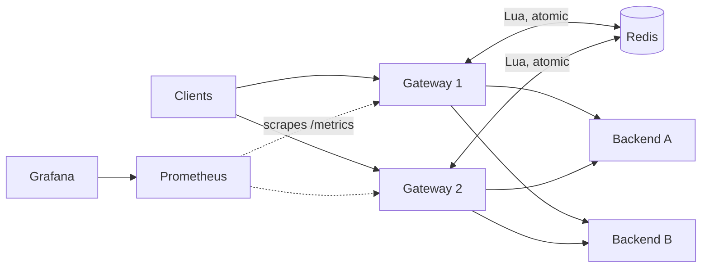

# Distributed Rate-Limiting API Gateway

A reverse proxy / API gateway in Go that sits in front of backend services. It enforces rate limits that stay correct across multiple gateway instances, sheds load instead of collapsing when a backend slows down, and reloads its config without a restart. The gateway itself depends only on the Go standard library.

> **Status:** work in progress. The gateway, limiters, resilience layer, config reload, local Docker stack, and tests are done. Terraform/AWS deployment and the AWS load-test report are not started. See [Roadmap](#roadmap).

## Architecture



Per request: route match, auth/API-key lookup, rate-limit decision (Redis, with a local fast path), then backend call through a circuit breaker and a bulkhead, under a per-route deadline.

## What's implemented

- **Three algorithms**, each in memory and as an atomic Redis Lua script: token bucket, sliding-window log, sliding-window counter.
- **Distributed enforcement:** shared state in Redis, using Redis `TIME` so gateway clock skew can't matter. An optional local fast path (lease batches and cached denies) cuts Redis round trips.
- **Resilience:** per-backend circuit breakers and concurrency limits (bulkheads), request deadlines, gateway-wide in-flight cap, and 429/503 load shedding.
- **Redis outage policy**, set globally or per route: `fail_open`, `fail_closed`, or `local_fallback` (enforce `limit / fallback_divisor` per instance in memory). A breaker on Redis itself stops every request from paying the timeout.
- **Dynamic config:** per-route and per-API-key limits, reloaded by file polling, HTTP polling, or `SIGHUP`. Unknown fields and invalid documents are rejected and the previous config stays live.
- **Observability:** Prometheus metrics, `/healthz`, `/readyz`, `/admin/config`, and a provisioned Grafana dashboard.

## Algorithm comparison

Measured with `cmd/algobench` (100 requests per 1s rule; full tables in [docs/algorithm-benchmark.md](docs/algorithm-benchmark.md)).

| Algorithm | Max in any 1s, steady overload | Memory per key (Redis) | In-process cost |
|---|---|---|---|
| `token_bucket` | 199 (1.99x, allows bursts) | 135 B | 141 ns/op |
| `sliding_window_log` | 100 (exact) | 5224 B | 376 ns/op |
| `sliding_window_counter` | 100 (approximate) | 121 B | 187 ns/op |

Why they differ: a token bucket lets a full bucket drain at once and then refill, so it permits a burst of up to capacity plus one window's refill. The sliding-window log stores a timestamp per request, so it is exact but costs memory proportional to the limit. The sliding-window counter blends the previous and current window counts, which gives near-log accuracy at near-bucket memory.

## Quick start

Requires Go 1.24 and Docker.

```bash
make up                     # 2 gateways + Redis + 2 backends + Prometheus + Grafana
curl localhost:18081/api/hello
curl localhost:18082/flaky/hello

# Burst test: ~100 burst + 100/s refill allowed, the rest get 429
seq 1000 | xargs -P 50 -I{} curl -s -o /dev/null -w "%{http_code}\n" localhost:18081/limited | sort | uniq -c
```

| Service | URL |
|---|---|
| Gateway 1 / 2 | http://localhost:18081 / http://localhost:18082 |
| Gateway admin | http://localhost:19091 / http://localhost:19092 (`/metrics`, `/readyz`, `/admin/config`) |
| Grafana (no login) | http://localhost:3000 (dashboard: *Gateway overview*) |
| Prometheus | http://localhost:9099 |

Every host port can be overridden, for example `GRAFANA_PORT=3001 make up`. Stop with `make down`.

Controlling the demo backends (latency and failure injection):

```bash
curl 'localhost:9002/__control?latency=300ms&fail=0.5'   # slow and flaky backend2
```

## Testing

```bash
make up                # or: docker compose -f deploy/compose/docker-compose.yml up -d redis
make test              # race detector; fails if any test is skipped
```

Redis-backed tests skip themselves when Redis is unreachable, so `make test` and CI treat any skip as a failure. `redisc` and `config` tests use an in-process fake and need no Redis.

CI (`.github/workflows/ci.yml`) runs gofmt, vet, build, and the full test suite against a Redis service, and builds the Docker image.

## Local load-test results

These come from `scripts/loadtest_local.py`, with the load generator, Redis, backend and two gateways all sharing one 2-CPU machine. Treat them as a floor for the code and as evidence of *behavior*, not as a capacity claim. Raw data is in [`results/`](results/). **AWS results are pending.**

**Limiter accuracy** (600 req/s offered to one identity across 2 gateways, limit 200/s, 10s):

| Algorithm | Allowed/s | Notes |
|---|---|---|
| token bucket | 220 | ideal is 200 plus 200 burst over 10s = 220 |
| sliding-window log | 200 | exact |
| sliding-window counter | 208 | about 4% over |

**Latency and throughput (no limiting, 5 ms backend):** 1000 req/s gave p50 6.9 ms and p99 11.2 ms. 2000 req/s gave p50 7.0 ms and p99 15.1 ms, with 0 errors in both runs.

**Fast path:** the same 2000 req/s run used 629 Redis calls instead of 20,000, with the same p99 (15.0 ms vs 15.1 ms). The cost is some extra over-admission, which is the accuracy-vs-round-trips trade-off.

**Slow backend (800 req/s):** without protection, every request was served, but p99 rose to 409 ms. With a bulkhead, deadline and breaker, p99 for served requests stayed at 12 ms and the gateway shed the excess with 503/504 (about 45% of requests at 800 req/s offered).

**Killed backend (800 req/s):** 6402 fast 503s (breaker open) and only 26 502s, instead of requests hanging.

**Redis down** (1500 req/s against a 500/s route, Redis down for part of the run): `fail_closed` rejected with 503, `local_fallback` kept enforcing a per-instance share, and `fail_open` admitted the most traffic. The policy is chosen per route, so a payment route can fail closed while a read route fails open.

Limitations: single machine, short runs (10 s), one trial each, no confidence intervals. The Redis-down figures mix periods with Redis up and down, so compare policies qualitatively, not by exact percentages.

## Configuration

See [`deploy/compose/config.json`](deploy/compose/config.json) for a working example. Edit the file while the stack is running and the gateways pick it up within 2 seconds (`reload-interval`), or send `SIGHUP`. Check the active version at `/admin/config`.

## Project layout

```
cmd/gateway     the gateway binary
cmd/backend     controllable fake backend (latency / failure injection)
cmd/loadgen     load generator used by the local load tests
cmd/algobench   algorithm accuracy / memory / latency benchmark
internal/limiter     the three algorithms (in-memory and Redis/Lua) + local fast path
internal/resilience  circuit breaker and bulkhead
internal/gateway     routing, policy, proxying, admin endpoints
internal/config      parsing, validation, hot reload
internal/redisc      minimal RESP client with pooling and EVALSHA
deploy/compose       local stack (Compose, Prometheus, Grafana)
```

## Roadmap

- [x] Gateway core, three limiters, Redis/Lua, fast path
- [x] Circuit breakers, bulkheads, deadlines, load shedding, Redis outage policy
- [x] Dynamic config reload
- [x] Local Docker stack, Prometheus, Grafana dashboard
- [x] Unit and integration tests, CI
- [ ] Terraform: VPC, ECS Fargate, ALB, ElastiCache, CloudWatch
- [ ] CD: plan on PR, apply on merge (OIDC)
- [ ] k6 load tests on AWS and a published report
