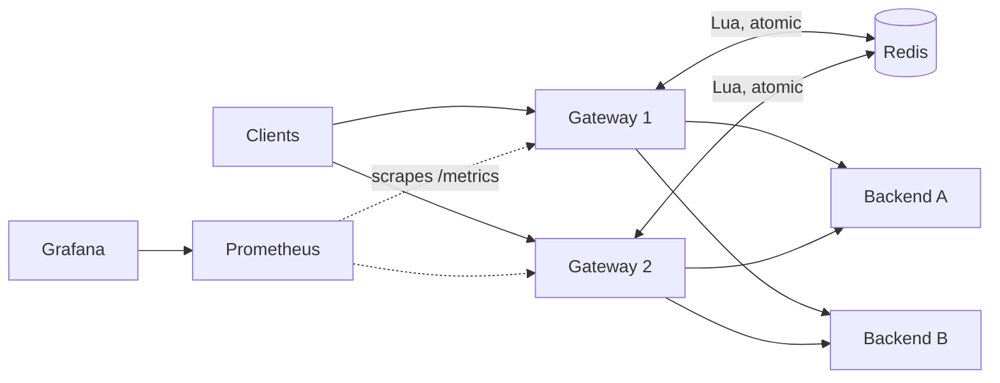
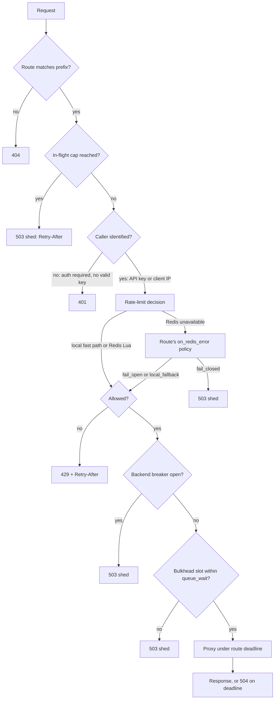

# Distributed Rate-Limiting API Gateway

[](https://github.com/Shubhoom123/ratelimit-gateway/actions/workflows/ci.yml)

A reverse proxy / API gateway in Go that sits in front of backend services. It enforces rate limits that stay correct across several gateway instances, sheds load instead of collapsing when a backend slows down, and reloads its config without a restart. The gateway itself uses only the Go standard library, including its own Redis client.

Everything runs locally with Docker Compose and costs nothing. Cloud deployment is out of scope on purpose ([ADR 0006](docs/adr/0006-local-only-zero-cost.md)).

## At a glance

| | |
|---|---|
| **Rate limiting** | Token bucket, sliding-window log, sliding-window counter; atomic Redis Lua scripts shared by all instances |
| **Fewer Redis calls** | Local fast path: 474-477 Redis calls instead of 20,000 at 2,000 req/s, same latency |
| **Overload** | With a backend slowed to 400 ms: p99 of served requests 10-11 ms (vs about 4,856 ms unprotected), at the cost of shedding 44% |
| **Redis outage** | Per-route policy: `fail_open`, `fail_closed` or `local_fallback` |
| **Operations** | Hot config reload, Prometheus metrics, Grafana dashboard, 7 alert rules, k6 scripts |
| **Quality** | Race-detector tests against real Redis, CI on every push, two reproducible local load-test runs |

## Architecture



### What happens to a request



Shed responses carry `Retry-After` and an `X-Shed-Reason` header. Rate-limited responses carry `X-RateLimit-Limit` and `X-RateLimit-Remaining`. A client that cancels, or a request the gateway sheds locally, is not counted as a backend failure, so it cannot trip the breaker.

## What's implemented

- **Three algorithms**, each in memory and as an atomic Redis Lua script: token bucket, sliding-window log, sliding-window counter.
- **Distributed enforcement:** shared state in Redis, using Redis `TIME` as the single clock so gateway clock skew can't matter. An optional local fast path (lease batches and cached denies) cuts Redis round trips.
- **Resilience:** per-backend circuit breakers (rolling window, half-open probes), bulkheads (bounded concurrency plus a short queue), per-route deadlines, a gateway-wide in-flight cap, and 429/503 load shedding.
- **Redis outage policy**, global or per route: `fail_open`, `fail_closed`, or `local_fallback` (enforce `limit / fallback_divisor` per instance in memory). A breaker on Redis itself stops every request from paying the timeout.
- **Dynamic config:** per-route and per-API-key limits, reloaded by file polling, HTTP polling, or `SIGHUP`. Unknown fields and invalid documents are rejected and the previous config stays live.
- **Observability:** Prometheus metrics, `/healthz`, `/readyz`, `/admin/config`, a provisioned Grafana dashboard and alert rules.

## Quick start

Requires Go 1.24 and Docker.

```bash
make up                     # 2 gateways + Redis + 2 backends + Prometheus + Grafana
curl localhost:18081/api/hello
curl localhost:18082/flaky/hello

# Burst test: ~100 burst + 100/s refill allowed, the rest get 429
seq 1000 | xargs -P 50 -I{} curl -s -o /dev/null -w "%{http_code}\n" localhost:18081/limited | sort | uniq -c
```

| Service | URL |
|---|---|
| Gateway 1 / 2 | http://localhost:18081 / http://localhost:18082 |
| Gateway admin | http://localhost:19091 / http://localhost:19092 (`/metrics`, `/readyz`, `/admin/config`) |
| Grafana (no login) | http://localhost:3000 (dashboard: *Gateway overview*) |
| Prometheus | http://localhost:9099 (alerts at `/alerts`) |

Every host port can be overridden, for example `GRAFANA_PORT=3001 make up`. Stop with `make down`.

Demo backends accept latency and failure injection:

```bash
curl 'localhost:9002/__control?latency=300ms&fail=0.5'   # slow and flaky backend2
```

### Make targets

| Target | What it does |
|---|---|
| `make up` / `make down` | Start / stop the local stack |
| `make build` | Build all binaries into `bin/` |
| `make test` | Race-detector tests; fails if any test is skipped |
| `make vet` / `make fmt` | `go vet`; fail if any file needs `gofmt` |
| `make loadtest-local` | Rerun the local load-test suite (`scripts/loadtest_local.py`) |

## Configuration

A working example is [`deploy/compose/config.json`](deploy/compose/config.json). Edit it while the stack runs and the gateways pick it up within 2 seconds, or send `SIGHUP`. The active version is at `/admin/config`.

| Field | Meaning |
|---|---|
| `redis.addr`, `redis.prefix`, `redis.pool_size`, `redis.timeout` | Redis location, key namespace, connection pool, per-call timeout (default 25 ms) |
| `redis.breaker` | Breaker for Redis calls: `window`, `min_requests`, `failure_ratio`, `open_for`, `probes` |
| `defaults` | Fallback limit: `algorithm`, `limit`, `window`, `burst` |
| `on_redis_error`, `fallback_divisor` | Global outage policy and the instance count used by `local_fallback` |
| `fast_path` | Local lease and deny cache: `enabled`, `lease_ttl`, `max_batch`, `max_deny_ttl` |
| `max_in_flight` | Gateway-wide concurrent request cap (0 = unlimited) |
| `trust_xff` | Use the last `X-Forwarded-For` hop as the client IP (only behind a trusted proxy) |
| `backends.<name>` | `url`, `max_concurrent`, `queue_wait`, `breaker` |
| `routes[]` | `name`, `prefix`, `backend`, `limit`, `timeout`, `auth` (`optional`/`required`), `on_redis_error`, `strip_prefix` |
| `api_keys.<key>` | `name`, `limit` for all routes, `routes.<route>` for a per-route override |

Limits resolve in this order: per-key per-route override, per-key override, route, defaults. Callers are charged to their API key if it is known, otherwise to their client IP. An unknown `X-API-Key` is charged to the IP so random keys can't create unlimited identities.

Setting `on_redis_error` per route lets a payment route fail closed while a read route fails open.

## Algorithm comparison

Measured with `cmd/algobench` (100 requests per 1 s rule; full tables in [docs/algorithm-benchmark.md](docs/algorithm-benchmark.md)).

| Algorithm | Max in any 1s, steady overload | Memory per key (Redis) | In-process cost |
|---|---|---|---|
| `token_bucket` | 199 (1.99x, allows bursts) | 135 B | 141 ns/op |
| `sliding_window_log` | 100 (exact) | 5224 B | 376 ns/op |
| `sliding_window_counter` | 100 (approximate) | 121 B | 187 ns/op |

A token bucket lets a full bucket drain at once and then refill, so it permits a burst of up to capacity plus one window's refill. The sliding-window log stores a timestamp per request, so it is exact but costs memory proportional to the limit. The sliding-window counter blends the previous and current window counts, which gives near-log accuracy at near-bucket memory.

## Design decisions

Short records of why it works the way it does, each tied to code and measurements: [docs/adr](docs/adr/README.md). They cover why a token bucket allows bursts and a sliding-window counter does not, how races across instances are avoided, the fail-open vs fail-closed trade-off, and what happens to latency under overload. For interview preparation there is also [docs/interview-notes.md](docs/interview-notes.md).

## Testing

```bash
make up                # or: docker compose -f deploy/compose/docker-compose.yml up -d redis
make test              # race detector; fails if any test is skipped
```

Redis-backed tests skip themselves when Redis is unreachable, so `make test` and CI treat any skip as a failure. If `make test` reports skips, Redis isn't running on `:6379`. The `redisc` and `config` tests use an in-process fake and need no Redis.

CI ([`.github/workflows/ci.yml`](.github/workflows/ci.yml)) runs gofmt, vet, build and the full test suite against a Redis service, and builds the Docker image.

## Local load-test results

Two complete runs of `scripts/loadtest_local.py` on one 2-CPU machine, with the load generator, Redis, backend and both gateways sharing those CPUs. Treat them as a floor for the code and as evidence of *behavior*, not as a capacity claim. Full tables for both runs are in [docs/loadtest-report.md](docs/loadtest-report.md); raw data is in [`results/`](results/).

**Limiter accuracy** (600 req/s offered to one identity across 2 gateways, limit 200/s, 10 s):

| Algorithm | Allowed/s (run 1, run 2) | Notes |
|---|---|---|
| token bucket | 220, 220 | exactly 200 burst plus 200/s refill over 10 s |
| sliding-window log | 200, 200 | exact |
| sliding-window counter | 206, 202 | about 1-3% over |

**Baseline (no limiting, 5 ms backend):** 1000 req/s gave p50 6.6-6.7 ms and p99 7.9-8.4 ms. 2000 req/s gave p50 6.4-6.6 ms and p99 9.1-10.6 ms. Zero errors in every run.

**Fast path:** at 2000 req/s it used 474-477 Redis calls instead of 20,000 with the same latency. Under heavy overload it saves much less (5,273-5,501 of 6,000 calls), because most requests there are denials that still have to be checked.

**Slow backend** (latency jumps from 5 ms to 400 ms mid-run, 800 req/s for 20 s). Protection trades throughput for latency, so read both rows:

| | Served successfully | Latency of served requests (p99) | Failed or shed |
|---|---|---|---|
| No protection | 14,496 (90.6%) | about 4,856 ms | 9.4% (client timeouts and 504s) |
| Bulkhead + deadline + breaker | 8,770 (54.8%) | 10-11 ms | 44.3% shed with 503, 0.9% 504 |

Without protection most requests succeed, but the queue behind the slow backend grows until requests hit the 5 s timeout. With protection the gateway answers 55% quickly and rejects the rest immediately.

**Killed backend** (down for 7 s, 800 req/s): about 40% fast 503s from the open breaker and only 0.3-0.4% 502s, with p99 of 10-13 ms, instead of requests hanging.

**Redis down for 7 s** (1500 req/s against a 500/s route): `fail_open` admitted about 900/s, `local_fallback` 575-625/s, and `fail_closed` 324-374/s. The ordering repeated, but exact numbers did not, because outage timing against the Redis breaker shifts the counts.

Limitations: one machine, 10-20 s runs, two trials, no confidence intervals, and injected backend latency. There is no cloud network between gateway and Redis.

### k6 scripts

Three k6 scripts in [`loadtest/k6`](loadtest/k6/README.md) run through Docker, so nothing needs installing:

```bash
bash loadtest/k6/run.sh smoke          # 500 rps for 20 s; thresholds p95<50ms, p99<100ms, <1% errors
bash loadtest/k6/run.sh accuracy       # 600 rps on /limited for 10 s; allowed count must be 1000-1250
bash loadtest/k6/run.sh slow_backend   # backend slows to 400 ms mid-run; served p99 must stay under 150 ms
```

Last local run: smoke p95 8.5 ms and p99 17.8 ms with 0% errors; accuracy allowed 1,099 of 6,001; slow backend served 54.7% and shed 43.8% with served p99 of 11 ms. With Redis stopped, `local_fallback` still admitted 1,098 (each gateway enforces `limit / 2`).

## Monitoring and alerts

The Grafana dashboard (*Gateway overview*) shows request rate by route and status, latency p50/p95/p99, rate-limit decisions by source and result, load shed by reason, breaker state, bulkhead slots in use, in-flight requests, Redis errors and round trips, and config reloads.

[`deploy/compose/alerts.yml`](deploy/compose/alerts.yml) holds 7 Prometheus alert rules, visible at http://localhost:9099/alerts:

| Alert | Fires when |
|---|---|
| `GatewayDown` | A gateway stops answering scrapes |
| `RedisBreakerOpen` | The Redis breaker was open or half-open at any point in the last 30 s, for 15 s |
| `RedisErrors` | Failed Redis calls exceed 1/s for 30 s |
| `BackendBreakerOpen` | A backend breaker was open or half-open within 30 s |
| `HighLoadShedding` | More than 10% of requests are shed, for 1 minute |
| `HighP99Latency` | A route's p99 latency is above 500 ms, for 2 minutes |
| `ConfigReloadRejected` | A config reload was rejected in the last 5 minutes |

The breaker alerts look at the last 30 s because a failing dependency flips between open and half-open every second or two, so a plain "state equals open" check would almost never hold. To see one fire: `docker compose -f deploy/compose/docker-compose.yml stop redis`, send traffic to `/limited` for 30 s, and watch `RedisBreakerOpen` go pending then firing.

## Project layout

```
cmd/gateway          the gateway binary
cmd/backend          controllable fake backend (latency / failure injection)
cmd/loadgen          load generator used by the local load tests
cmd/algobench        algorithm accuracy / memory / latency benchmark
internal/limiter     the three algorithms (in-memory and Redis/Lua) + local fast path
internal/resilience  circuit breaker and bulkhead
internal/gateway     routing, policy, proxying, admin endpoints
internal/config      parsing, validation, hot reload
internal/metrics     small Prometheus-format registry
internal/redisc      minimal RESP client with pooling and EVALSHA
deploy/compose       local stack (Compose, Prometheus rules, Grafana)
loadtest/k6          k6 scripts
scripts              local load-test driver
docs                 ADRs, algorithm benchmark, load-test report, interview notes
results              raw data behind the load-test report
```

## Known limitations

- The sliding-window counter script builds its per-window keys inside the script instead of receiving them in `KEYS`. They share a hash tag, so they land in the same slot, but it isn't strictly Redis Cluster-safe and has only been run against a single Redis node ([ADR 0002](docs/adr/0002-atomic-lua-and-redis-time.md)).
- `local_fallback` divides the limit by `fallback_divisor`, a static estimate of the instance count. If instances scale, update the divisor.
- The local fast path trades a bounded amount of accuracy for fewer Redis calls ([ADR 0003](docs/adr/0003-local-fast-path.md)).
- Load-test numbers come from one laptop-class machine and are evidence of behavior, not capacity.
- No TLS, no authentication beyond optional API keys, and no persistent storage of limiter state across a Redis restart. This is a learning and portfolio project, not a hardened product.

## Roadmap

- [x] Gateway core, three limiters, Redis/Lua, fast path
- [x] Circuit breakers, bulkheads, deadlines, load shedding, Redis outage policy
- [x] Dynamic config reload
- [x] Local Docker stack, Prometheus, Grafana dashboard
- [x] Unit and integration tests, CI
- [x] Reproducible local load tests (two clean runs)
- [x] Prometheus alert rules
- [x] k6 load-test scripts
- [x] Design write-ups (architecture decision records)
