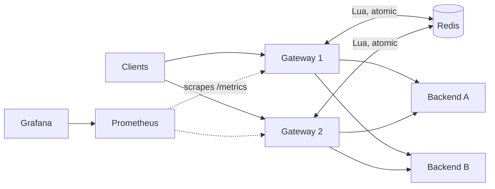

# Distributed Rate-Limiting API Gateway

A reverse proxy / API gateway in Go that sits in front of backend services. It enforces rate limits that stay correct across multiple gateway instances, sheds load instead of collapsing when a backend slows down, and reloads its config without a restart. The gateway itself depends only on the Go standard library.

> **Status:** the gateway, limiters, resilience layer, config reload, local Docker stack, tests, CI and local load tests are done. It runs entirely locally and costs nothing. See [Roadmap](#roadmap).

## Architecture



Per request: route match, auth/API-key lookup, rate-limit decision (Redis, with a local fast path), then backend call through a circuit breaker and a bulkhead, under a per-route deadline.

## What's implemented

- **Three algorithms**, each in memory and as an atomic Redis Lua script: token bucket, sliding-window log, sliding-window counter.
- **Distributed enforcement:** shared state in Redis, using Redis `TIME` so gateway clock skew can't matter. An optional local fast path (lease batches and cached denies) cuts Redis round trips.
- **Resilience:** per-backend circuit breakers and concurrency limits (bulkheads), request deadlines, gateway-wide in-flight cap, and 429/503 load shedding.
- **Redis outage policy**, set globally or per route: `fail_open`, `fail_closed`, or `local_fallback` (enforce `limit / fallback_divisor` per instance in memory). A breaker on Redis itself stops every request from paying the timeout.
- **Dynamic config:** per-route and per-API-key limits, reloaded by file polling, HTTP polling, or `SIGHUP`. Unknown fields and invalid documents are rejected and the previous config stays live.
- **Observability:** Prometheus metrics, `/healthz`, `/readyz`, `/admin/config`, and a provisioned Grafana dashboard.

## Algorithm comparison

Measured with `cmd/algobench` (100 requests per 1s rule; full tables in [docs/algorithm-benchmark.md](docs/algorithm-benchmark.md)).

| Algorithm | Max in any 1s, steady overload | Memory per key (Redis) | In-process cost |
|---|---|---|---|
| `token_bucket` | 199 (1.99x, allows bursts) | 135 B | 141 ns/op |
| `sliding_window_log` | 100 (exact) | 5224 B | 376 ns/op |
| `sliding_window_counter` | 100 (approximate) | 121 B | 187 ns/op |

Why they differ: a token bucket lets a full bucket drain at once and then refill, so it permits a burst of up to capacity plus one window's refill. The sliding-window log stores a timestamp per request, so it is exact but costs memory proportional to the limit. The sliding-window counter blends the previous and current window counts, which gives near-log accuracy at near-bucket memory.

## Quick start

Requires Go 1.24 and Docker.

```bash
make up                     # 2 gateways + Redis + 2 backends + Prometheus + Grafana
curl localhost:18081/api/hello
curl localhost:18082/flaky/hello

# Burst test: ~100 burst + 100/s refill allowed, the rest get 429
seq 1000 | xargs -P 50 -I{} curl -s -o /dev/null -w "%{http_code}\n" localhost:18081/limited | sort | uniq -c
```

| Service | URL |
|---|---|
| Gateway 1 / 2 | http://localhost:18081 / http://localhost:18082 |
| Gateway admin | http://localhost:19091 / http://localhost:19092 (`/metrics`, `/readyz`, `/admin/config`) |
| Grafana (no login) | http://localhost:3000 (dashboard: *Gateway overview*) |
| Prometheus | http://localhost:9099 |

Every host port can be overridden, for example `GRAFANA_PORT=3001 make up`. Stop with `make down`.

Controlling the demo backends (latency and failure injection):

```bash
curl 'localhost:9002/__control?latency=300ms&fail=0.5'   # slow and flaky backend2
```

## Testing

```bash
make up                # or: docker compose -f deploy/compose/docker-compose.yml up -d redis
make test              # race detector; fails if any test is skipped
```

Redis-backed tests skip themselves when Redis is unreachable, so `make test` and CI treat any skip as a failure. `redisc` and `config` tests use an in-process fake and need no Redis.

CI (`.github/workflows/ci.yml`) runs gofmt, vet, build, and the full test suite against a Redis service, and builds the Docker image.

## Local load-test results

Two complete runs of `scripts/loadtest_local.py` on one 2-CPU machine, with the load generator, Redis, backend and both gateways sharing those CPUs. Treat them as a floor for the code and as evidence of *behavior*, not as a capacity claim. Full tables for both runs are in [docs/loadtest-report.md](docs/loadtest-report.md); raw data is in [`results/`](results/). Everything runs locally and costs nothing.

**Limiter accuracy** (600 req/s offered to one identity across 2 gateways, limit 200/s, 10 s):

| Algorithm | Allowed/s (run 1, run 2) | Notes |
|---|---|---|
| token bucket | 220, 220 | exactly 200 burst plus 200/s refill over 10 s |
| sliding-window log | 200, 200 | exact |
| sliding-window counter | 206, 202 | about 1-3% over |

**Baseline (no limiting, 5 ms backend):** 1000 req/s gave p50 6.6-6.7 ms and p99 7.9-8.4 ms. 2000 req/s gave p50 6.4-6.6 ms and p99 9.1-10.6 ms. Zero errors in every run.

**Fast path:** at 2000 req/s it used 474-477 Redis calls instead of 20,000 with the same latency. Under heavy overload it saves much less (5,273-5,501 of 6,000 calls), because most requests there are denials that still have to be checked.

**Slow backend** (latency jumps from 5 ms to 400 ms mid-run, 800 req/s for 20 s). Protection trades throughput for latency, so read both rows:

| | Served successfully | Latency of served requests (p99) | Failed or shed |
|---|---|---|---|
| No protection | 14,496 (90.6%) | about 4,856 ms | 9.4% (client timeouts and 504s) |
| Bulkhead + deadline + breaker | 8,770 (54.8%) | 10-11 ms | 44.3% shed with 503, 0.9% 504 |

Without protection most requests succeed, but the queue behind the slow backend grows until requests hit the 5 s timeout. With protection the gateway answers 55% quickly and rejects the rest immediately.

**Killed backend** (down for 7 s, 800 req/s): about 40% fast 503s from the open breaker and only 0.3-0.4% 502s, with p99 of 10-13 ms, instead of requests hanging.

**Redis down for 7 s** (1500 req/s against a 500/s route): `fail_open` admitted about 900/s, `local_fallback` 575-625/s, and `fail_closed` 324-374/s. The ordering repeated, but exact numbers did not, because outage timing against the Redis breaker shifts the counts. The policy is chosen per route, so a payment route can fail closed while a read route fails open.

Limitations: one machine, 10-20 s runs, two trials, no confidence intervals, and injected backend latency. There is no cloud network between gateway and Redis.

## Configuration

See [`deploy/compose/config.json`](deploy/compose/config.json) for a working example. Edit the file while the stack is running and the gateways pick it up within 2 seconds (`reload-interval`), or send `SIGHUP`. Check the active version at `/admin/config`.

## Project layout

```
cmd/gateway     the gateway binary
cmd/backend     controllable fake backend (latency / failure injection)
cmd/loadgen     load generator used by the local load tests
cmd/algobench   algorithm accuracy / memory / latency benchmark
internal/limiter     the three algorithms (in-memory and Redis/Lua) + local fast path
internal/resilience  circuit breaker and bulkhead
internal/gateway     routing, policy, proxying, admin endpoints
internal/config      parsing, validation, hot reload
internal/redisc      minimal RESP client with pooling and EVALSHA
deploy/compose       local stack (Compose, Prometheus, Grafana)
```

## Roadmap

- [x] Gateway core, three limiters, Redis/Lua, fast path
- [x] Circuit breakers, bulkheads, deadlines, load shedding, Redis outage policy
- [x] Dynamic config reload
- [x] Local Docker stack, Prometheus, Grafana dashboard
- [x] Unit and integration tests, CI
- [x] Reproducible local load tests (two clean runs)
- [ ] Prometheus alert rules
- [ ] k6 load-test scripts
- [ ] Design write-ups (architecture decision records)

Cloud deployment is out of scope on purpose: the project runs entirely locally and costs nothing to run or test.
