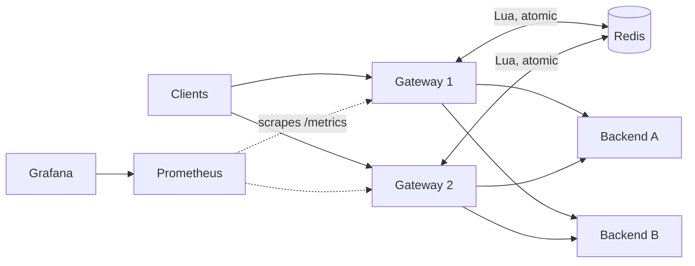
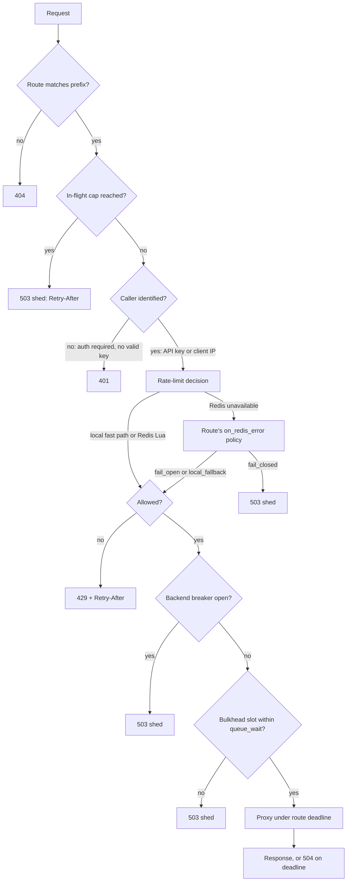

# Distributed rate-limiting API gateway

[](https://github.com/Shubhoom123/ratelimit-gateway/actions/workflows/ci.yml)

A reverse proxy in Go that sits in front of backend services. Several gateway instances share their rate limits through Redis, so a limit holds no matter which instance a request lands on. When a backend slows down, the gateway rejects extra work quickly instead of queueing it, and config changes apply without a restart. The gateway uses only the Go standard library, including its own Redis client.

It all runs locally with Docker Compose and costs nothing. I left cloud deployment out on purpose, and [ADR 0006](docs/adr/0006-local-only-zero-cost.md) explains why.

## At a glance

| | |
|---|---|
| Rate limiting | Token bucket, sliding-window log and sliding-window counter, run as atomic Lua scripts in Redis |
| Redis round trips | 474-477 calls instead of 20,000 at 2,000 req/s with the local fast path, at the same latency |
| Overload | With a backend slowed to 400 ms, served requests had a p99 of 10-11 ms instead of about 4,856 ms, and 44% of requests were shed |
| Redis outage | Each route picks `fail_open`, `fail_closed` or `local_fallback` |
| Operations | Hot config reload, Prometheus metrics, a Grafana dashboard, 7 alert rules, k6 scripts |
| Testing | Race-detector tests against a real Redis, CI on every push, two repeatable local load-test runs |

## Architecture



### What happens to a request



Shed responses carry `Retry-After` and an `X-Shed-Reason` header. Rate-limited responses carry `X-RateLimit-Limit` and `X-RateLimit-Remaining`. If a client cancels, or the gateway sheds a request itself, that doesn't count as a backend failure. Otherwise shedding could trip the breaker and make the overload worse.

## What it does

- Three rate-limit algorithms, each in memory and as an atomic Redis Lua script: token bucket, sliding-window log and sliding-window counter.
- Shared limits across instances. State lives in Redis, and the scripts read Redis `TIME`, so clock skew between gateways can't matter. An optional local fast path takes small batches of tokens and caches recent denials to cut Redis round trips.
- Protection for backends: a circuit breaker per backend (rolling window, half-open probes), a bulkhead per backend (bounded concurrency plus a short queue), a deadline per route, a gateway-wide in-flight cap, and 429/503 shedding.
- A choice of what to do when Redis is down, globally or per route. `fail_open` admits everything, `fail_closed` rejects everything, and `local_fallback` enforces `limit / fallback_divisor` per instance in memory. A breaker on Redis itself stops every request from waiting out the timeout.
- Config reload by file polling, HTTP polling or `SIGHUP`, with per-route and per-API-key limits. Unknown fields and invalid documents are rejected, and the previous config stays live.
- Prometheus metrics, `/healthz`, `/readyz`, `/admin/config`, a provisioned Grafana dashboard and alert rules.

## Quick start

You need Go 1.24 and Docker.

```bash
make up                     # 2 gateways + Redis + 2 backends + Prometheus + Grafana
curl localhost:18081/api/hello
curl localhost:18082/flaky/hello

# Burst test: about 100 burst + 100/s refill gets through, the rest get 429
seq 1000 | xargs -P 50 -I{} curl -s -o /dev/null -w "%{http_code}\n" localhost:18081/limited | sort | uniq -c
```

| Service | URL |
|---|---|
| Gateway 1 / 2 | http://localhost:18081 / http://localhost:18082 |
| Gateway admin | http://localhost:19091 / http://localhost:19092 (`/metrics`, `/readyz`, `/admin/config`) |
| Grafana (no login) | http://localhost:3000, dashboard "Gateway overview" |
| Prometheus | http://localhost:9099 (alerts at `/alerts`) |

Every host port can be overridden, for example `GRAFANA_PORT=3001 make up`. Stop everything with `make down`.

The demo backends accept latency and failure injection:

```bash
curl 'localhost:9002/__control?latency=300ms&fail=0.5'   # slow, flaky backend2
```

### Make targets

| Target | What it does |
|---|---|
| `make up` / `make down` | Start or stop the local stack |
| `make build` | Build all binaries into `bin/` |
| `make test` | Run the tests with the race detector, and fail if any test is skipped |
| `make vet` / `make fmt` | Run `go vet`, or fail if a file needs `gofmt` |
| `make loadtest-local` | Rerun the local load-test suite (`scripts/loadtest_local.py`) |

## Configuration

[`deploy/compose/config.json`](deploy/compose/config.json) is a working example. Edit it while the stack runs and the gateways pick the change up within 2 seconds, or send `SIGHUP`. `/admin/config` shows the active version.

| Field | Meaning |
|---|---|
| `redis.addr`, `redis.prefix`, `redis.pool_size`, `redis.timeout` | Redis address, key namespace, connection pool size, per-call timeout (default 25 ms) |
| `redis.breaker` | Breaker for Redis calls: `window`, `min_requests`, `failure_ratio`, `open_for`, `probes` |
| `defaults` | Fallback limit: `algorithm`, `limit`, `window`, `burst` |
| `on_redis_error`, `fallback_divisor` | Global outage policy, and the instance count that `local_fallback` divides by |
| `fast_path` | Local lease and deny cache: `enabled`, `lease_ttl`, `max_batch`, `max_deny_ttl` |
| `max_in_flight` | Cap on concurrent requests across the gateway (0 means unlimited) |
| `trust_xff` | Use the last `X-Forwarded-For` hop as the client IP, only behind a proxy you trust |
| `backends.<name>` | `url`, `max_concurrent`, `queue_wait`, `breaker` |
| `routes[]` | `name`, `prefix`, `backend`, `limit`, `timeout`, `auth` (`optional` or `required`), `on_redis_error`, `strip_prefix` |
| `api_keys.<key>` | `name`, a `limit` for all routes, and `routes.<route>` for per-route overrides |

Limits resolve in this order: per-key per-route override, per-key override, route, defaults. A request is charged to its API key if the gateway knows the key, and to the client IP otherwise. An unknown `X-API-Key` is charged to the IP so that random keys can't create unlimited identities.

Because `on_redis_error` can be set per route, a payment route can fail closed while a read route fails open.

## Algorithm comparison

Measured with `cmd/algobench` on a rule of 100 requests per second. The full tables are in [docs/algorithm-benchmark.md](docs/algorithm-benchmark.md).

| Algorithm | Max in any 1 s, steady overload | Memory per key (Redis) | In-process cost |
|---|---|---|---|
| `token_bucket` | 199 (1.99x, allows bursts) | 135 B | 141 ns/op |
| `sliding_window_log` | 100 (exact) | 5224 B | 376 ns/op |
| `sliding_window_counter` | 100 (approximate) | 121 B | 187 ns/op |

A token bucket that has sat idle is full, so it can hand out its whole capacity at once and then keep refilling. That is where the 199 comes from. The sliding-window log stores a timestamp for every request, which makes it exact and makes its memory grow with the limit. The sliding-window counter blends the counts of the previous and current windows, so it lands close to the log's accuracy at close to the bucket's memory.

## Design decisions

The [ADRs](docs/adr/README.md) record why each part works the way it does, with the code and measurements behind it. They cover why a token bucket allows bursts and a sliding-window counter doesn't, how instances avoid racing each other, the fail-open versus fail-closed trade-off, and what happens to latency under overload. [docs/interview-notes.md](docs/interview-notes.md) has talking points for explaining the project.

## Testing

```bash
make up                # or: docker compose -f deploy/compose/docker-compose.yml up -d redis
make test              # race detector; fails if any test is skipped
```

The Redis-backed tests skip themselves when Redis isn't reachable, so `make test` and CI treat any skip as a failure. If `make test` reports skips, Redis isn't running on `:6379`. The `redisc` and `config` tests use an in-process fake and don't need Redis.

[CI](.github/workflows/ci.yml) runs gofmt, vet, the build and the full test suite against a Redis service, then builds the Docker image.

## Local load-test results

Everything below comes from two complete runs of `scripts/loadtest_local.py` on one 2-CPU machine. The load generator, Redis, the backend and both gateways all shared those two CPUs, so read the numbers as a floor for the code and as evidence of behavior, not as a capacity claim. [docs/loadtest-report.md](docs/loadtest-report.md) has the full tables for both runs, and [`results/`](results/) has the raw data.

### Limiter accuracy

600 req/s offered to one identity across 2 gateways, limit 200/s, 10 s:

| Algorithm | Allowed/s (run 1, run 2) | Notes |
|---|---|---|
| token bucket | 220, 220 | 200 burst plus 200/s refill over 10 s |
| sliding-window log | 200, 200 | exact |
| sliding-window counter | 206, 202 | about 1-3% over |

### Baseline

With no limiting and a 5 ms backend, 1000 req/s gave a p50 of 6.6-6.7 ms and a p99 of 7.9-8.4 ms. At 2000 req/s the p50 was 6.4-6.6 ms and the p99 was 9.1-10.6 ms. There were no errors in any run.

### Fast path

At 2000 req/s the fast path made 474-477 Redis calls instead of 20,000, with the same latency. It saves much less under heavy overload (5,273-5,501 of 6,000 calls), because most requests there are denials, and a denial has to be rechecked as soon as its retry hint expires.

### Slow backend

Backend latency jumps from 5 ms to 400 ms mid-run, at 800 req/s for 20 s. Protection trades throughput for latency, so read both columns:

| | Served successfully | p99 of served requests | Failed or shed |
|---|---|---|---|
| No protection | 14,496 (90.6%) | about 4,856 ms | 9.4% (client timeouts and 504s) |
| Bulkhead, deadline and breaker | 8,770 (54.8%) | 10-11 ms | 44.3% shed with 503, 0.9% 504 |

Without protection most requests succeed, but the queue behind the slow backend keeps growing until requests hit the 5 s client timeout. With protection the gateway answers 55% of requests quickly and turns the rest away immediately.

### Killed backend

With a backend down for 7 s at 800 req/s, about 40% of requests got a fast 503 from the open breaker and only 0.3-0.4% got a 502. The p99 stayed at 10-13 ms, and nothing hung.

### Redis down

Redis was down for 7 s while 1500 req/s hit a route limited to 500/s. `fail_open` admitted about 900/s, `local_fallback` 575-625/s and `fail_closed` 324-374/s. The ordering repeated across runs but the exact numbers didn't, because the timing of the outage against the Redis breaker shifts the counts.

### What these runs don't show

They ran on one machine for 10-20 s each, with two trials and no confidence intervals, and the backend latency was injected. There was no real network between the gateway and Redis.

### k6 scripts

Three k6 scripts in [`loadtest/k6`](loadtest/k6/README.md) run through Docker, so there is nothing to install:

```bash
bash loadtest/k6/run.sh smoke          # 500 rps for 20 s; p95 < 50 ms, p99 < 100 ms, < 1% errors
bash loadtest/k6/run.sh accuracy       # 600 rps on /limited for 10 s; allowed count must be 1000-1250
bash loadtest/k6/run.sh slow_backend   # backend slows to 400 ms mid-run; served p99 must stay under 150 ms
```

In my last local run, smoke gave a p95 of 8.5 ms and a p99 of 17.8 ms with 0% errors. Accuracy let 1,099 of 6,001 requests through. In the slow-backend run 54.7% of requests were served and 43.8% were shed, with a served p99 of 11 ms. With Redis stopped, `local_fallback` still let 1,098 through, because each gateway enforces half the limit by itself.

## Monitoring and alerts

The Grafana dashboard "Gateway overview" shows request rate by route and status, latency p50, p95 and p99, rate-limit decisions by source and result, load shed by reason, breaker state, bulkhead slots in use, in-flight requests, Redis errors and round trips, and config reloads.

[`deploy/compose/alerts.yml`](deploy/compose/alerts.yml) defines 7 Prometheus alert rules, which you can see at http://localhost:9099/alerts:

| Alert | Fires when |
|---|---|
| `GatewayDown` | A gateway stops answering scrapes |
| `RedisBreakerOpen` | The Redis breaker was open or half-open at some point in the last 30 s, for 15 s |
| `RedisErrors` | Failed Redis calls stay above 1/s for 30 s |
| `BackendBreakerOpen` | A backend breaker was open or half-open within the last 30 s, for 15 s |
| `HighLoadShedding` | More than 10% of requests are shed, for 1 minute |
| `HighP99Latency` | A route's p99 is above 500 ms, for 2 minutes |
| `ConfigReloadRejected` | A config reload was rejected in the last 5 minutes |

The breaker alerts look back 30 s because a failing dependency flips between open and half-open every second or two. A plain "state equals open" check almost never holds long enough to fire. To watch one fire, run `docker compose -f deploy/compose/docker-compose.yml stop redis`, send traffic to `/limited` for 30 s, and check `RedisBreakerOpen` on the alerts page. It goes pending first, then firing.

## Project layout

```
cmd/gateway          the gateway binary
cmd/backend          controllable fake backend (latency / failure injection)
cmd/loadgen          load generator used by the local load tests
cmd/algobench        algorithm accuracy / memory / latency benchmark
internal/limiter     the three algorithms (in-memory and Redis/Lua) + local fast path
internal/resilience  circuit breaker and bulkhead
internal/gateway     routing, policy, proxying, admin endpoints
internal/config      parsing, validation, hot reload
internal/metrics     small Prometheus-format registry
internal/redisc      minimal RESP client with pooling and EVALSHA
deploy/compose       local stack (Compose, Prometheus rules, Grafana)
loadtest/k6          k6 scripts
scripts              local load-test driver
docs                 ADRs, algorithm benchmark, load-test report, interview notes
results              raw data behind the load-test report
```
